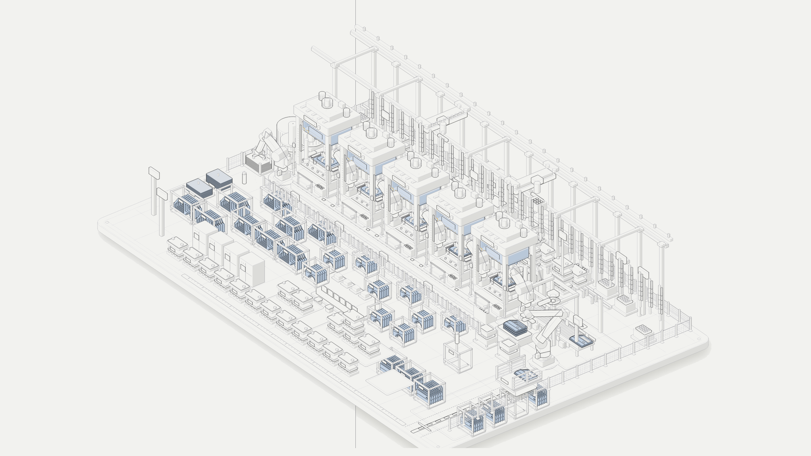
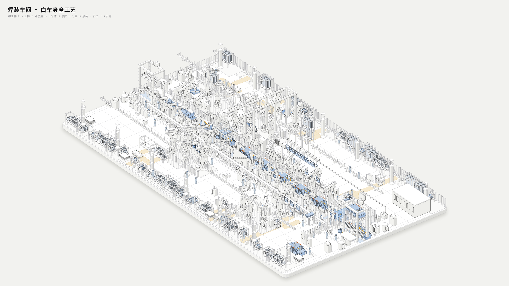
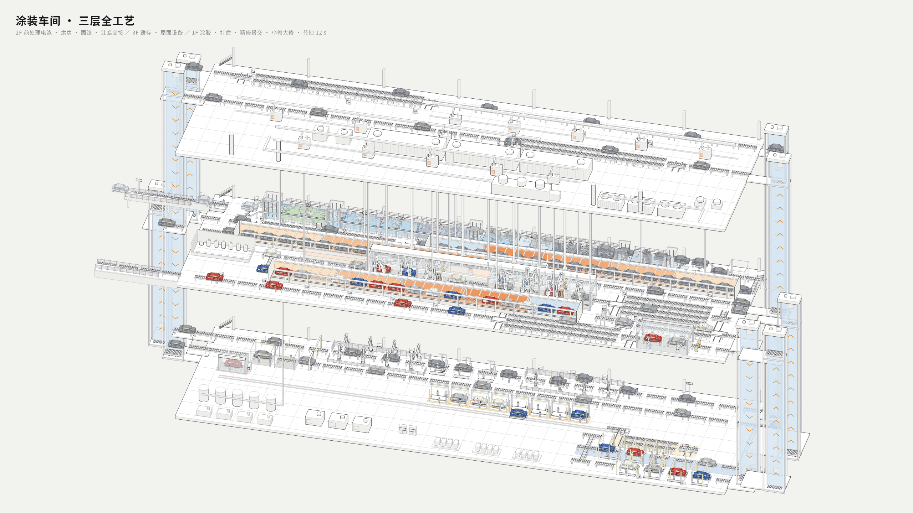
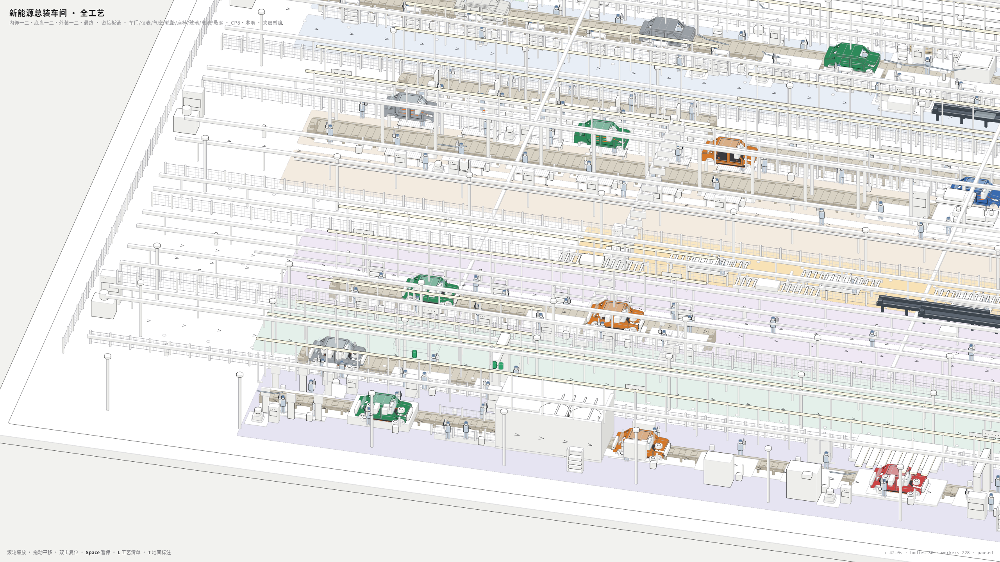
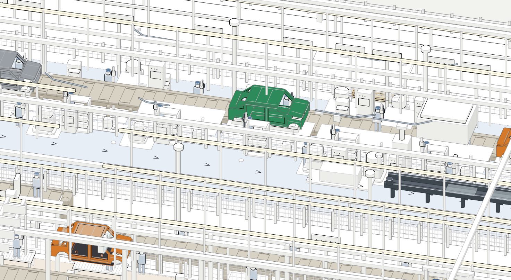
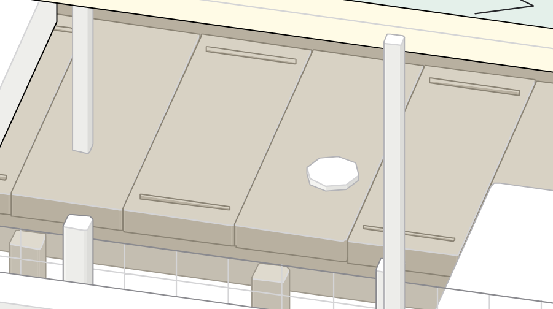
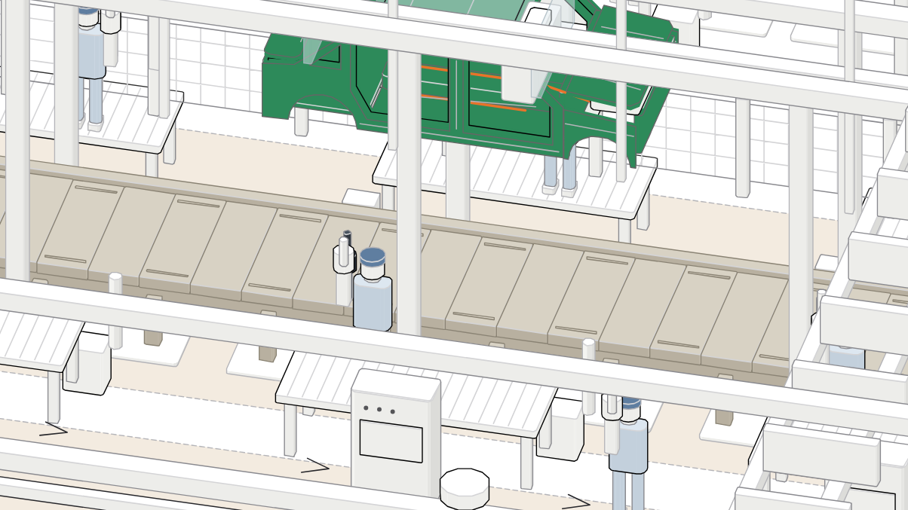
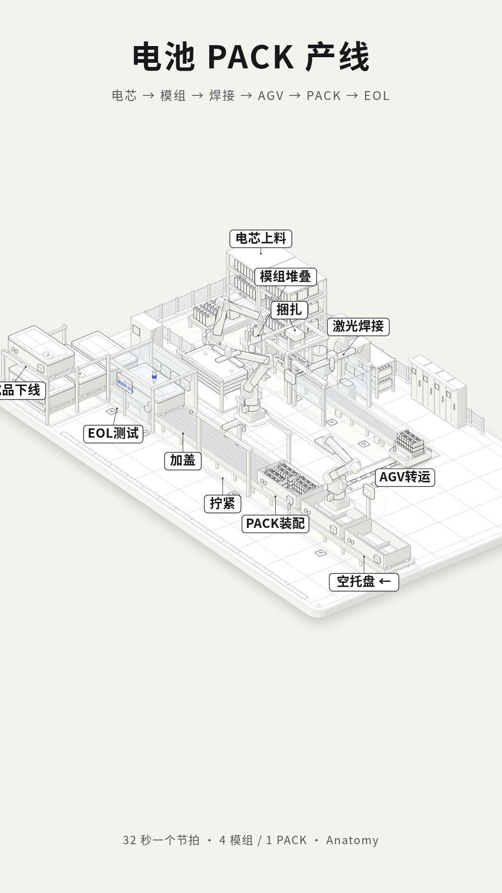

# Factory Anatomy

整车厂冲焊涂总等车间的 **等轴测交互 SVG / HTML** 作品集，用于演示、短视频与方案讲解。

基于 [Anatomy](https://github.com/wheresryan22/anatomy) isometric SVG skill（MIT）的独立展示仓，非上游 fork。

## Gallery

| 场景 | 预览 | 说明 |
| :--- | :---: | :--- |
| **冲压** Press Shop |  | 五连冲压线 · AGV 下料 |
| **焊装** Body Shop |  | BIW 总览 |
| **涂装** Paint Shop |  | 三层：电泳 / 面漆 / 精修 |
| **总装** Assembly Shop |  | 整体合装 · 双主线 · 板链 |
| 总装细节 |    | 双线 · 板链密接 · 线上作业 |
| **电池包** Battery Pack |  | Pack 线 |

## What’s inside

| Scene | Interactive HTML | Notes |
| --- | --- | --- |
| 冲压 Press Shop | `figures/stamping-jier-line-light.html` | 五连冲压线 |
| 焊装 Body Shop | `figures/bodyshop-biw-desktop-light.html` | BIW 总览 |
| 涂装 Paint Shop | `figures/paintshop-3f-desktop-light.html` | 三层：电泳 / 面漆 / 精修 |
| 总装 Assembly Shop | `figures/assembly-nev-desktop-light.html` | 整体合装 + 双主线 + 板链 |
| 电池包 Battery Pack | `figures/battery-pack-line-light.html` | Pack 线 |

> 大体积 HTML 在 `figures/`。快速浏览用上表截图；要看动画请在桌面浏览器打开 HTML。

## Credits

- Visual language & kit: [wheresryan22/anatomy](https://github.com/wheresryan22/anatomy) (MIT)
- Factory process scenes: Senthee / 吴斌 & assistants (2026)

## License

- Upstream Anatomy kit: MIT（见 `LICENSE-anatomy.txt`）
- 本仓场景与文档：MIT（见 `LICENSE`）
